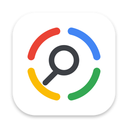
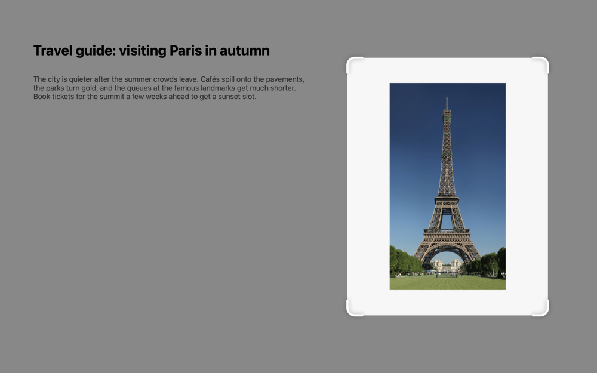
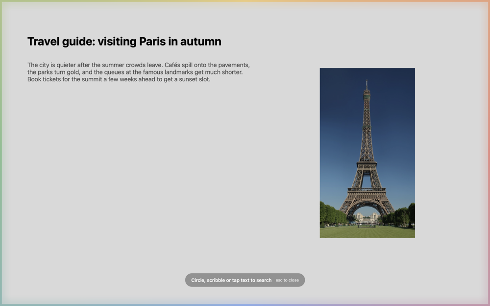
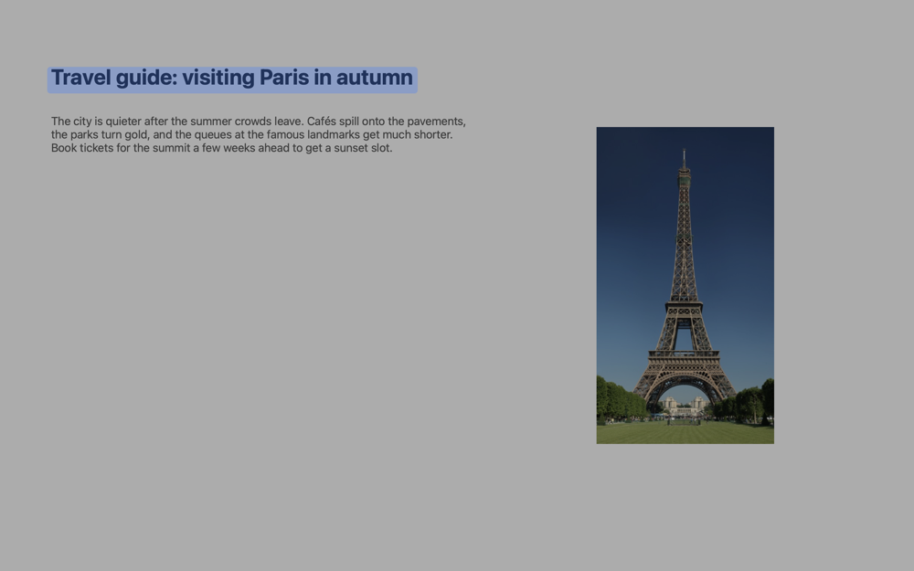
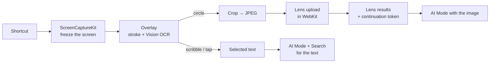

<div align="center">
  
  <h1>Halo Search</h1>
  <p><strong>Circle anything on your Mac's screen and ask Google about it.</strong></p>
  <p>A native macOS take on the "circle to search" gesture from Pixel and Galaxy phones.<br>
  Results open in Google AI Mode and Google Search, side by side, without leaving what you're doing.</p>

  <a href="https://github.com/buwaneka-halpage/halo-search/actions/workflows/ci.yml"></a>
  
  
  <a href="LICENSE"></a>
</div>

<p align="center">
  <a href="https://github.com/buwaneka-halpage/halo-search/releases/download/v0.1.0/halo-search-demo.mp4"></a><br>
  <a href="https://github.com/buwaneka-halpage/halo-search/releases/download/v0.1.0/halo-search-demo.mp4"><strong>▶ Watch the 50-second demo</strong></a>
</p>

## Features

- **Circle to search** — draw around anything; the region is searched as an image. AI Mode explains what it is,
  and Google Lens finds visual matches.
- **Scribble or tap text** — highlight words and Halo Search searches exactly that text, read on-device with Vision.
- **Ask follow-ups** — type a question about what you circled and AI Mode answers with the image in context.
- **Adjust and retry** — drag the selection's corners, or draw again, while results stay open.
- **Stays out of the way** — a menu bar app with a global shortcut; links open in your normal browser.
- **Your Google account** — optionally sign in once for personalised AI Mode; the session persists.

| Idle | Scribble over text |
| --- | --- |
|  |  |

## Install

1. Download `HaloSearch-<version>.zip` from [Releases](https://github.com/buwaneka-halpage/halo-search/releases)
   and move **Halo Search.app** to Applications.
2. Releases are not notarised yet, so macOS blocks the first launch. Open **System Settings → Privacy &
   Security** and choose **Open Anyway** (or run `xattr -dr com.apple.quarantine "/Applications/Halo Search.app"`).
3. When asked, allow **Screen & System Audio Recording**, then relaunch the app.

Or [build it yourself](#build-from-source) — it takes about a minute.

## Use

Press **⌃⇧Space** anywhere (change it from the menu bar icon → Shortcut).

| Do this | To |
| --- | --- |
| Circle something | Search it as an image in AI Mode and Lens |
| Scribble over text, or tap a word | Search that text |
| Drag a corner of the selection | Resize it and search again |
| Type in the panel's box | Ask a follow-up (image) or edit the query (text) |
| <kbd>⌘1</kbd> / <kbd>⌘2</kbd> | Switch between AI Mode and Search |
| <kbd>⌘L</kbd> | Focus the question box |
| <kbd>Esc</kbd> or <kbd>⌘W</kbd> | Close |

From the menu bar icon you can also choose which tab opens first, change the question AI Mode is asked about
images, sign in to Google, and launch at login.

## How it works



The circled region is posted to Google Lens from inside an embedded WebKit view, so it behaves like a normal
browser visit with your own cookies. Once Lens has analysed the image, its results page carries a single-use
token; opening AI Mode with that token and the Lens session ID gives AI Mode the image. The details, and why
each piece is built the way it is, are in [docs/ARCHITECTURE.md](docs/ARCHITECTURE.md).

## Privacy

Nothing leaves your Mac until you make a selection. The screen is captured locally, text recognition runs
on-device, and only the region you circle (or the text you select) is sent — to Google, the same as searching
on google.com. There is no analytics or server of our own. See [PRIVACY.md](PRIVACY.md).

## Build from source

Requires macOS 14+ and Swift 5.10+. The Xcode Command Line Tools are enough.

```sh
git clone https://github.com/buwaneka-halpage/halo-search.git
cd halo-search
scripts/build.sh --install   # builds "Halo Search.app", copies it to /Applications and launches it
scripts/test.sh              # unit tests
```

[docs/DEVELOPMENT.md](docs/DEVELOPMENT.md) covers the project layout, the live self-test that checks the
Google integration end to end, and how releases are made.

## Roadmap

Signed and notarised builds, a settings window, tap-to-select objects, translation, QR codes, and more
search providers are planned. See [docs/ROADMAP.md](docs/ROADMAP.md) and the
[issues](https://github.com/buwaneka-halpage/halo-search/issues).

## Contributing

Bug reports and pull requests are welcome — see [CONTRIBUTING.md](CONTRIBUTING.md).

## Acknowledgements

Two open projects showed this was possible: [CircleFlow](https://github.com/keekyslusus/CircleFlow) for
Windows, which first continued a Lens result in AI Mode, and
[Circle2Search](https://github.com/sijan2/Circle2Search) for macOS. Halo Search is an independent
implementation and contains no code from either.

## Disclaimer

Halo Search is not affiliated with or endorsed by Google. Google, Google Lens, AI Mode and Circle to Search are
trademarks of Google LLC. Halo Search uses Google's public web pages rather than an official API, so a change on
Google's side can break part of it until it is updated, and your use of Google remains subject to
[Google's Terms of Service](https://policies.google.com/terms).

## License

[MIT](LICENSE) © 2026 Buwaneka Halpage
