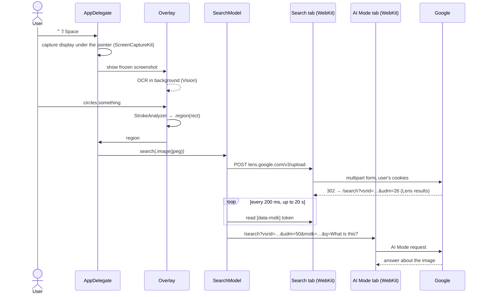

# Architecture

Halo Search is a small menu bar app written in Swift with AppKit, SwiftUI, ScreenCaptureKit, Vision and WebKit.
It has no dependencies outside Apple's SDKs.

## Layout

```
Sources/
├── HaloSearchCore/            Pure logic, no UI. Fully unit tested.
│   ├── GoogleSearch.swift     Builds every Google request; recognises the pages that come back
│   ├── PageScripts.swift      JavaScript run inside Google's pages (the part most likely to break)
│   ├── StrokeAnalyzer.swift   Turns a freehand stroke into "image region", "text" or "nothing"
│   └── TextSelection.swift    OCR result types; joins selected words back into text
└── HaloSearch/                The app
    ├── App/                   Entry point, menu bar, global shortcut, settings
    ├── Capture/               ScreenCaptureKit capture, Vision text recognition
    ├── Overlay/               Full-screen frozen screenshot, stroke drawing, selection
    ├── Results/               Results panel (SwiftUI) and the two WebKit views behind it
    └── Diagnostics/           --selftest and --render-overlay harnesses
Tests/HaloSearchCoreTests/     Swift Testing suites for the core library
```

The split is deliberate: everything that can be tested without a screen, a window server or the network lives in
`HaloSearchCore`, so the tests run in CI in milliseconds. The app target is a thin layer that wires Apple frameworks
to that logic.

## A search, step by step



### 1. Shortcut and capture

`HotKey` registers the shortcut with Carbon's `RegisterEventHotKey`, which works without the Accessibility
permission that event taps need. `ScreenCapturer` grabs the display under the pointer at native resolution with
`SCScreenshotManager`, excluding the app's own windows. Capturing *before* showing the overlay is what makes the
screen look frozen, as on Android.

### 2. Overlay and gestures

`OverlayView` is layer-backed: the screenshot, a dimming layer with an even-odd "hole" for the selection, a conic
gradient spinning behind a soft border mask for the edge glow, the stroke, the corner brackets and a shimmer. All
animation is Core Animation, so drawing stays smooth on large displays.

While the overlay is visible, `TextRecognizer` runs Vision OCR over the screenshot and records each word's
rectangle. When a stroke ends, `StrokeAnalyzer` decides what it meant:

- **Tap** (smaller than 8 pt): the word under it, or nothing.
- **Mostly on words** (≥ 45 % of evenly resampled points fall on word rectangles): a text selection, with gaps on
  each line filled in so a quick swipe still selects every word it crossed.
- **Anything else**: an image region — the stroke's bounding box, padded and kept at least 48 pt across.

Resampling the stroke at even spacing first means a fast flick and a slow careful line are judged alike.

### 3. Searching an image

Both result tabs are `WKWebView`s sharing the default website data store, so a Google sign-in persists and both
tabs see the same session.

- **Why upload from WebKit, not `URLSession`?** A form post made by the web view carries the user's cookies and
  consent state, and if Google shows its "unusual traffic" check the user can solve it right there. The Lens
  response is a redirect to an ordinary results page, which the Search tab simply displays.
- **Getting the image into AI Mode.** Lens results include a `data-mstk` attribute once the image has been analysed
  (usually 1–2 s). AI Mode accepts that token together with the Lens session ID (`vsrid`) and `udm=50`, and then
  answers about the image. The token is single use, so follow-up questions are typed into AI Mode's own box
  (`PageScripts.askFollowUp`) instead of building a new URL.
- **Fallbacks.** If the token never appears, the Search tab stays useful and a notice explains why AI Mode is
  missing. If the follow-up box can't be found, the question is asked as a text-only AI Mode search.

### 4. Searching text

Text needs no upload: AI Mode opens `/search?udm=50&q=…` and Search opens `/search?q=…` in parallel.

### 5. Links and focus

`SearchModel` keeps Google search, sign-in and consent pages in the panel and sends everything else — including
Google's `/url?q=` redirects, unwrapped — to the default browser, then closes the overlay. Escape is handled by a
local event monitor so it works whether the overlay, the panel or a web view has focus.

## Things that will break, and where to look

Halo Search depends on Google's web pages, not a published API. When something stops working:

| Symptom | Likely cause | Where |
| --- | --- | --- |
| Search tab blank after circling | Lens upload endpoint or form field changed | `GoogleSearch.lensUpload` |
| "AI Mode didn't accept this image" | Token attribute renamed | `PageScripts.lensToken` |
| AI Mode opens but ignores the image | AI Mode URL parameters changed | `GoogleSearch.aiMode(about:…)` |
| Follow-ups asked without the image | AI Mode's question box changed | `PageScripts.askFollowUp` |

`HaloSearch --selftest <image>` checks all four against the live site in about 15 seconds; see
[DEVELOPMENT.md](DEVELOPMENT.md).
